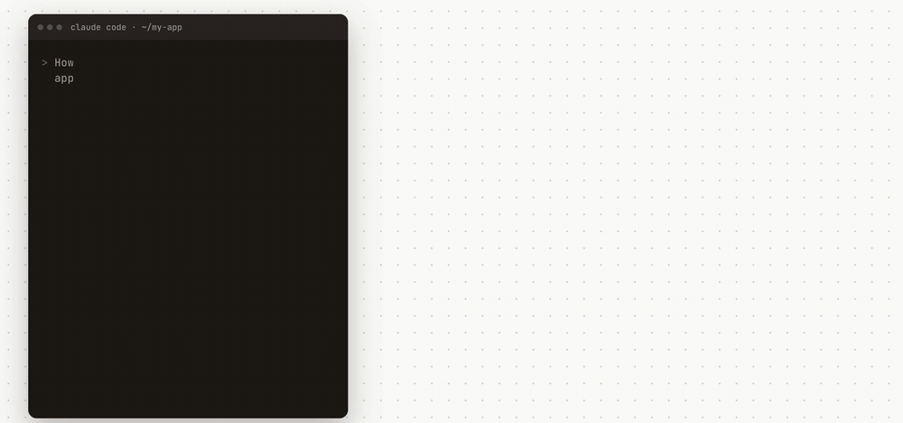
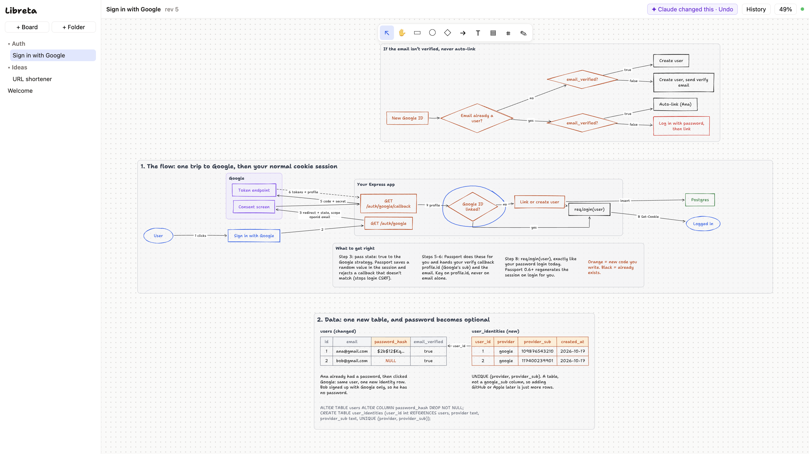
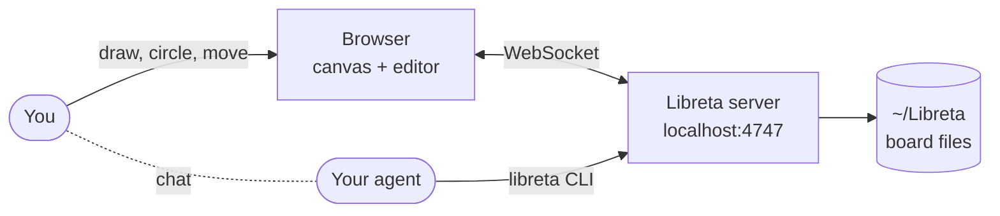

<div align="center">


# Libreta

**A whiteboard you and your AI agent share.**

Design, plan and explain things together. You keep talking in chat, and you both draw on the same
board: sketch an idea and the agent builds it out, ask how something works and it draws the
answer, circle what's unclear and ask about it.



</div>

## What it does

- **You both draw.** Sketch a rough idea and the agent turns it into a clean design. Change what it
  drew and it picks up your edits on its next turn.
- **Live, and laid out for you.** Frames, arrows, tables and notes appear in your browser as the
  agent draws them, already arranged.
- **Point instead of describe.** Circle, cross out, underline, move or sketch on the board, then
  ask in chat. The agent knows what you marked: a loop around a step reads as `circles <that step>`.
- **Who did what.** Every change is kept. Hover one to see what it touched, replay how the idea
  grew, or restore any version.
- **Plain local files.** Boards are JSON files in `~/Libreta`, so folders, Finder and git just work.
- **Any coding agent.** Claude Code, Codex, Cursor: anything that can run shell commands.



## How it works



The agent reads the board as text (every shape, what you selected, what you changed) and writes it
with short commands. The server places, routes and checks everything, so the agent's drawings
come out clean without it measuring pixels.

## Install

Needs Node 24 or newer.

```sh
git clone https://github.com/Angeloyo/libreta && cd libreta
npm install
npm run build                                        # builds the web app the server serves
ln -s "$PWD/bin/libreta" ~/.local/bin/libreta        # puts `libreta` on your PATH (any folder on PATH works)
```

Deleted boards go to `~/Libreta/.trash`. Set `LIBRETA_HOME` to keep boards somewhere else.

### Connect your agent

**Claude Code:** link the skill, and it works in every project.

```sh
ln -s "$PWD/.claude/skills/libreta" ~/.claude/skills/libreta
```

**Any other agent:** add this to its global instructions (for Codex, `~/.codex/AGENTS.md`):

```md
When an idea is easier to see than read (architecture, flows, plans, comparisons), draw it on
the Libreta whiteboard with the `libreta` CLI. Run `libreta guide` once per session and follow it.
```

Then set `LIBRETA_AGENT` to its name (`export LIBRETA_AGENT=codex`) so History shows who did what.
Inside Claude Code the name is set for you.

## Use it

```sh
libreta new "Ideas/First board" --open   # the server starts by itself
```

Then ask your agent to explain something on the board. It will:

- run `libreta read` to see the board, what you have selected, and what you changed
- draw with `libreta diagram` (auto-laid-out graphs) or `libreta apply` (anything else)
- check its work with `libreta look` (a PNG of the board)
- check what you changed (`libreta changes`) at the start of each turn, so you can edit at your
  own pace and just tell it when to look (ask it to "watch the board" if you want it to react live
  instead)

The "✦ Claude changed this · Undo" button (named after your agent) rejects its latest change.

**History** (top right) lists who did what, newest first:

- Hover a change to highlight what it touched on the board.
- Click it to see the board as it was then. "Restore this" makes that the current version; it's undoable.
- Press ▶ to replay the board being built, step by step.

Your agent can see the same list with `libreta history`.

<details>
<summary><b>Keyboard shortcuts</b></summary>

| Key | Action |
|---|---|
| `v` | select |
| `h` | pan |
| `r` | box |
| `o` | ellipse |
| `d` | diamond |
| `a` | arrow |
| `t` | text |
| `n` | sticky |
| `f` | frame |
| `p` | pen |
| Enter / double-click | edit text |
| ⌫ | delete |
| ⌘Z / ⇧⌘Z | undo / redo |
| ⇧1 | fit to content |
| space-drag, scroll | pan |
| ⌘-scroll, pinch | zoom |

</details>

## Development

```sh
npm run server         # the server, restarting on changes (port 4747)
npm run web            # Vite dev server on :5173 with hot reload; set LIBRETA_WEB_URL=http://localhost:5173 for `libreta open`
npm test               # engine tests
npm run check          # type-check
```

<details>
<summary><b>Code map</b></summary>

- `src/core`: the engine, shared by server and browser
  - `model.ts`: the board format
  - `ops.ts`, `dsl.ts`: the edit operations and the line format
  - `apply.ts`, `layout.ts`, `arrows.ts`, `text.ts`: placement, routing, measurement
  - `lint.ts`, `view.ts`, `ink.ts`: what the agent reads
  - `render.ts`: SVG
  - `diagram.ts`: ELK auto-layout
- `src/server`: the HTTP API for the CLI, the WebSocket for browsers, the library on disk
- `src/cli`: the `libreta` command
- `src/web`: the React app
  - `canvas/view.ts`: rendering and camera
  - `canvas/editor.ts`: tools and gestures
- `.claude/skills/libreta/SKILL.md`: how the agent should use it (also printed by `libreta guide`)

</details>

## Credits

The hand-drawn font is [Shantell Sans](https://github.com/arrowtype/shantell-sans) by Shantell
Martin and Arrow Type, under the SIL Open Font License (`assets/fonts/OFL.txt`).
